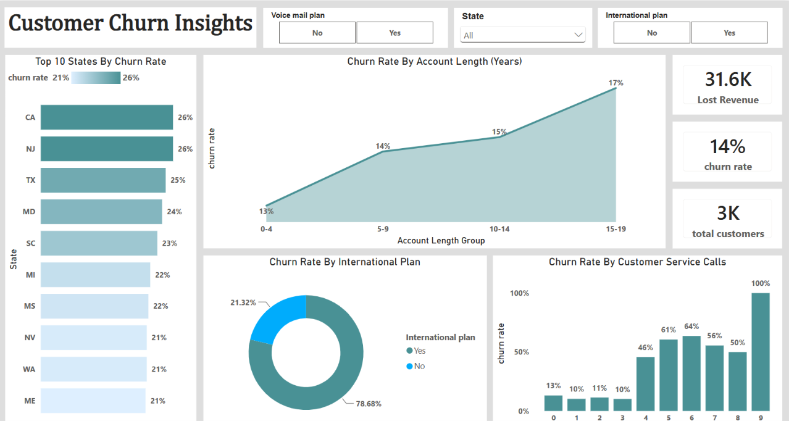
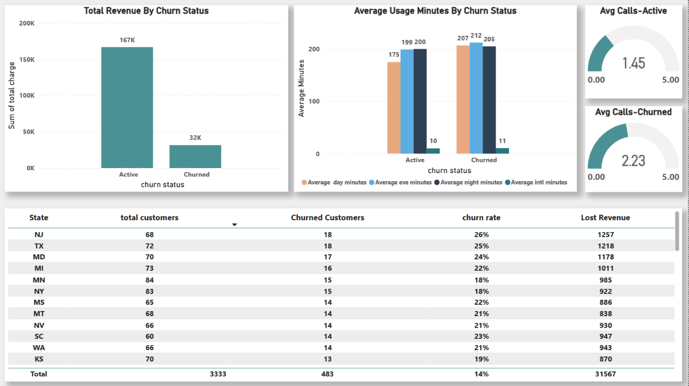

# Customer Churn Insights

A two-page Power BI dashboard that analyzes **3,333 telecom customers** to find out why customers leave and when to step in.

**Tools:** Power BI · DAX · Power Query

**Dataset:** Telecom customer churn dataset (3,333 customers)

## Business question
Why do customers leave, and what early-warning signals can the company act on?

## Key findings
- **Overall churn is 14%** (483 of 3,333 customers), about **$31.6K** in lost revenue.
- **Customer service calls are the clearest signal.** Churn is 10–13% at 0–3 calls, jumps to **46% at 4 calls** and reaches **61% at 5 calls**. Customers who stayed averaged **1.45** calls, those who left **2.23**.
- **Long-standing customers are at risk too.** Churn rises from 13% (0–4 years) to **17%** (15–19 years).
- **California and New Jersey** have the highest churn at **26%**, followed by Texas at 25%.
- Churned customers used more daytime minutes on average (207 vs 175).

## Recommendations
1. Create an automatic alert when an account reaches **3 support calls**, so the team can act before the 4-call jump.
2. Review pricing and service for the longest-standing customers (15–19 years).
3. Study service quality and competition in California and New Jersey.

## What's in the dashboard
- **Page 1:** churn rate, lost revenue, total customers, top 10 states by churn rate, churn by account length, by international plan and by service calls.
- **Page 2:** revenue, usage minutes and average calls for active vs churned customers, plus a state table with churned customers and lost revenue.
- Slicers: voice mail plan, state, international plan.

## How it was built
1. Cleaned and prepared the data in Power Query.
2. Wrote DAX measures for churn rate and lost revenue.
3. Applied conditional formatting and cross-filtering for a better user experience.
